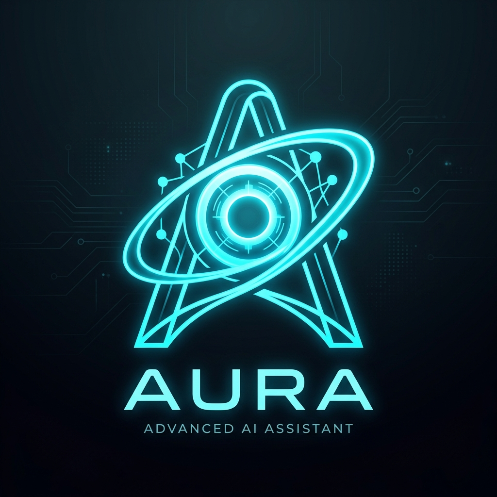

# AURA 2.0 — Autonomous Utility & Response Agent



**AURA 2.0** is a locally-hosted, fully autonomous multi-modal AI assistant paired with a **Cinematic Sci-Fi Landing Page** and a full-screen **Tactical HUD Command Console**. Powered by the [Ollama](https://ollama.com/) framework running the **Gemma 4 E2B** model for cognition and **Qwen3-VL 4B** for vision, AURA 2.0 provides advanced agentic planning, computer vision, local security scanning, long-term memory, continuous voice interactions, and system telemetry—all without sending your data to the cloud.

---

## ⚡ Highlights

- **100% Local Inference:** Zero cloud reliance — total data privacy.
- **Cinematic Landing Page:** WebGL nebula shaders, 3D wireframe globe, boot sequence simulation, Web Audio SFX, interactive terminal, and feature comparison.
- **Tactical HUD Interface:** Real-time sci-fi dashboard featuring live diagnostics, hardware thermals, waveform audio visualizer, and command console.
- **Advanced Agentic Planner:** AURA 2.0 creates temporary multi-step execution plans to achieve complex goals, verifying its actions automatically.
- **Vision & GUI Control:** Full integration of Vision (VLM + OCR) allowing AURA to read the screen and safely control Windows via mouse and keyboard commands (`pyautogui`).
- **Continuous Voice Interaction:** Advanced barge-in (interruption), silence detection, and continuous conversation mode using Edge-TTS and OpenWakeWord ("Hey Aura").
- **Persistent Long-Term Memory:** Semantic memory search lets AURA remember preferences, devices, and recurring tasks automatically.
- **Local Security Center:** A robust local monitoring suite for detecting suspicious processes, network connections, firewall status, and newly downloaded files.
- **Proactive Telemetry System:** Runs continuously in the background, pushing alerts for high CPU, RAM, or Disk usage, and triggering morning briefings.
- **System Tray Daemon:** Runs quietly in the background via a system tray icon for quick access to the HUD and Landing Page.

---

## 🚀 Interactive Interfaces

| Interface | URL | Description |
|-----------|-----|-------------|
| **Cinematic Landing Page** | `http://127.0.0.1:8000/` | Interactive showcase with 3D globe, WebGL shaders, sound effects, system specs, live terminal, and preview carousel. |
| **Tactical Command HUD** | `http://127.0.0.1:8000/hud.html` | The primary operational dashboard with live voice recognition, system telemetry, and agent chat. |
| **System Tray Icon** | `tray.py` | Right-click the AURA icon in your Windows taskbar for quick launch options and background processing. |

---

## 🛠️ AURA 2.0 Unified Architecture

AURA 2.0 aggregates all its subsystems into a single, unified cognitive architecture:

```text
               [ AURA: Gemma 4 E2B ]
                         │
      ┌──────────┬───────┼───────┬──────────┐
      ▼          ▼       ▼       ▼          ▼
   Vision     Memory  Planner  System     Voice
      │          │       │       │          │
 Screenshot  Long-term Multi-step Windows  STT/TTS
 OCR & VLM   knowledge execution  Control Wake word
      │          │       │       │          │
      └──────────┴───────┼───────┴──────────┘
                         ▼
                  [ Tool System ]
                         │
            ┌────────────┼────────────┐
            ▼            ▼            ▼
           Web       Smart Home    Security
```

### Core Subsystems:
1. **Vision:** Captures active screen content and processes it via Tesseract OCR and the local `qwen3-vl:4b` vision model to safely execute GUI interactions.
2. **Memory:** Dual-layer architecture (`memory.json` for short-term and `long_term_memory.json` for semantic facts).
3. **Planner:** An internal execution loop that creates temporary plans, reports progress via HUD toasts, and asks for confirmation on risky steps.
4. **System:** Deep integration via `psutil`, `wmi`, and `winreg` for telemetry, and safe desktop manipulation via `pyautogui`.
5. **Voice:** Edge-TTS combined with PyAudio/Sounddevice and OpenWakeWord, fully supporting barge-in and conversational looping.
6. **Security Center:** Scans for rogue executables, open listening ports, and Windows Defender profiles natively.

---

## 📦 Prerequisites

- **Python 3.10+**
- **Windows OS** (required for WMI telemetry, Registry access, and certain security tools)
- **Ollama** installed and running ([Download Ollama](https://ollama.com/download))
- **Gemma 4** model pulled locally:
  ```bash
  ollama pull gemma4:e2b
  ```
- **Qwen3-VL 4B** model for the vision pipeline:
  ```bash
  ollama pull qwen3-vl:4b
  ```
- **Microphone & Speakers** for full voice capabilities
- **Tesseract OCR** for screen vision support ([Download Tesseract](https://github.com/UB-Mannheim/tesseract/wiki))

---

## 🔧 Installation & Setup

1. **Clone the Repository:**
   ```bash
   git clone https://github.com/your-repo/aura.git
   cd aura
   ```

2. **Install Dependencies:**
   ```bash
   pip install -r requirements.txt
   ```

3. **Install Hardware & Audio Extras (Recommended):**
   ```bash
   pip install wmi pypiwin32 edge-tts pygame pystray pyautogui pygetwindow
   ```

4. **Configure Environment:**
   Create or verify `.env` in the root directory:
   ```env
   OLLAMA_MODEL=gemma4:e2b
   OLLAMA_VISION_MODEL=qwen3-vl:4b
   ```

---

## 🎮 Running AURA

### 1. Automated Launch (Recommended)
Simply double click `start_aura.bat`. This script automatically requests Administrator privileges (needed for hardware telemetry and security scanning) and launches the `tray.py` daemon. The system will start invisibly in the background. Look for the AURA icon in your system tray!

### 2. Manual Web Server Launch
Start the FastAPI / Uvicorn server directly:
```bash
python -m uvicorn api:app --host 127.0.0.1 --port 8000
```
- Navigate to `http://127.0.0.1:8000/` for the **Cinematic Landing Page**.
- Navigate to `http://127.0.0.1:8000/hud.html` for the **Tactical Command HUD**.

### 3. Classic Terminal Mode
To run AURA exclusively in the CLI for text/voice interactions without the web server:
```bash
python main.py
```

---

## 📂 Project Architecture

```
├── api.py                    # FastAPI server (serves APIs, HUD, Landing Page, and Scheduler)
├── agent.py                  # Core agent reasoning, Ollama client & tool dispatcher
├── main.py                   # CLI terminal interface
├── tray.py                   # Windows System Tray daemon for background execution
├── vision.py                 # Multi-modal vision pipeline (OCR + Qwen3-VL)
├── voice.py                  # STT listening, Wake-word detection, & Edge-TTS
├── memory.py                 # Short-term and long-term conversation memory manager
├── config.py                 # Configuration & environment loader
├── proactive_config.json     # Background telemetry thresholds (CPU, RAM, Temp)
├── requirements.txt          # Python dependencies
├── memory.json               # Local short-term conversation context
├── long_term_memory.json     # Local long-term knowledge archive
├── static/
│   ├── index.html            # Cinematic landing page
│   ├── hud.html              # Tactical HUD interface
│   └── ...                   # Assets, CSS, JS
└── tools/
    ├── __init__.py               # Unified tool registration
    ├── system_tools.py           # OS, hardware telemetry & power control
    ├── windows_tools.py          # Deep Windows OS diagnostics & registry querying
    ├── computer_control_tools.py # GUI automation (mouse/keyboard via pyautogui)
    ├── security_tools.py         # Local threat scanning & firewall/port checks
    ├── planner_tools.py          # Multi-step goal execution
    ├── memory_tools.py           # Long-term knowledge database queries
    ├── smart_home_tools.py       # Smart home device integration
    └── ...                       # Other miscellaneous tools
```

---

## ⌨️ Landing Page Easter Eggs & Controls

- **Interactive Terminal:** Type `help`, `status`, `scan`, `whoami`, `ping`, `threat`, or `time` directly in the browser terminal.
- **Audio Toggle:** Click the speaker icon in the navigation bar to enable sci-fi Web Audio hover & action sound effects.
- **Konami Code:** Type `↑ ↑ ↓ ↓ ← → ← → B A` on the landing page for a secret visual overload!

---

## 🛡️ License

Created for personal and educational use. All subsystems local.
