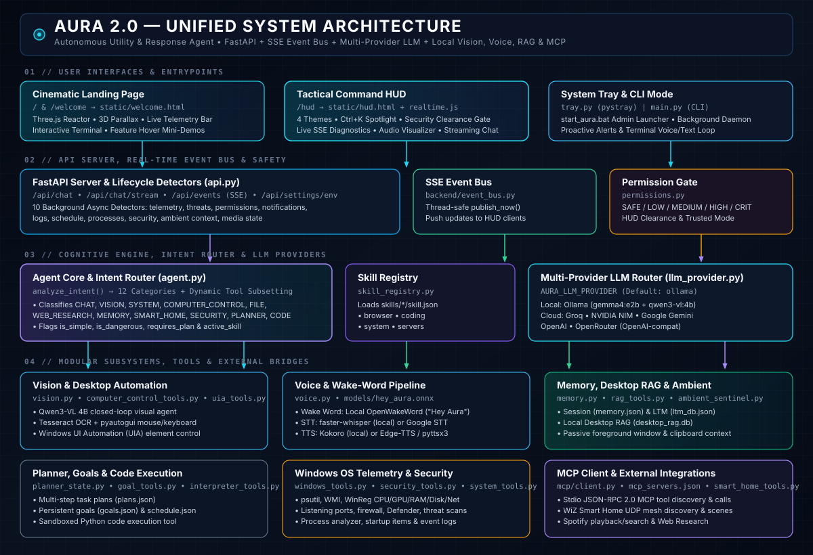
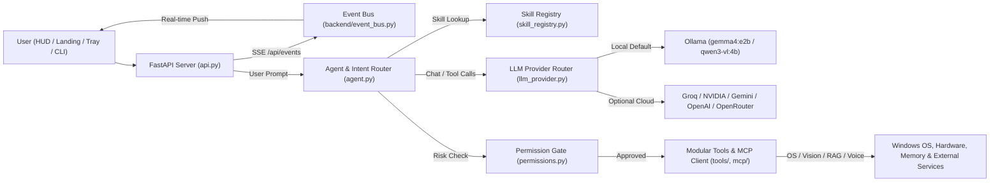

# AURA 2.0 — Autonomous Utility & Response Agent

<p align="center">
  
</p>

**AURA 2.0** is a locally-first, multi-modal autonomous AI assistant for Windows featuring a **Cinematic Landing Page**, a full-screen **Tactical HUD Command Console**, real-time **Server-Sent Events (SSE)** streaming, **Ambient Context Awareness**, **Local Desktop RAG**, and a **Model Context Protocol (MCP)** client.

By default, cognition and vision run **100% locally** via [Ollama](https://ollama.com/) (**Gemma 4 E2B** for reasoning and **Qwen3-VL 4B** for vision), with optional cloud LLM routing (`llm_provider.py`) for **Groq**, **NVIDIA NIM**, **Google Gemini**, **OpenAI**, and **OpenRouter**, plus configurable offline/cloud voice pipelines.

---

## ⚡ Highlights

- **Multi-Provider LLM Router (`llm_provider.py`):** Defaults to local Ollama (`gemma4:e2b` + `qwen3-vl:4b`) and supports seamless switching to Groq, NVIDIA NIM, Google Gemini, OpenAI, or OpenRouter via `.env` or HUD settings.
- **Cinematic Landing Page (`/` & `/welcome`):**
  - 3D mouse parallax tilt with smooth lerp momentum lag and 5-layer depth orbs.
  - Glowing Three.js orbital particle trails and interactive reactor (`static/reactor.js`).
  - CSS-only animated mini-demos on feature card hover, live hero telemetry bar, and interactive browser terminal.
- **Tactical HUD Command Console (`/hud`):**
  - 4 Dynamic Color Themes: **Cyan (Default)**, **Crimson (Alert)**, **Emerald (Matrix)**, and **Violet (Psionic)** with persistent state.
  - Real-time SSE updates (`backend/event_bus.py` → `/api/events` → `static/realtime.js`) for hardware thermals, processes, security threats, notifications, media, and ambient context.
  - Quick panel search spotlight (`Ctrl + K`), streaming chat (`/api/chat/stream`), and **Security Clearance** approval modal.
- **Dynamic Intent Routing & Skills (`agent.py`, `skill_registry.py`):** Pre-processes user inputs to classify intent across 12 categories (`CHAT`, `VISION`, `SYSTEM`, `COMPUTER_CONTROL`, `FILE`, `WEB_RESEARCH`, `MEMORY`, `SMART_HOME`, `SECURITY`, `PLANNER`, `VOICE`, `CODE`), dynamically subsets tools, and loads domain skills from `skills/`.
- **Vision, UIA & GUI Desktop Automation:** Combines `qwen3-vl:4b`, Tesseract OCR, `pyautogui`, and **Windows UI Automation (`tools/uia_tools.py`)** to inspect windows and execute closed-loop visual tasks.
- **Offline-Capable Voice Pipeline (`voice.py`):**
  - Local OpenWakeWord (`models/hey_aura.onnx`) with VAD, persistence, speaking barge-in threshold, one-shot pre-roll, and optional speaker verification.
  - Configurable STT (`faster-whisper` local offline neural or Google SpeechRecognition) and TTS (`kokoro` local offline neural, Edge-TTS, or `pyttsx3` fallback).
- **Ambient Context Sentinel (`backend/ambient_sentinel.py`):** Passively monitors the foreground window, active application, and clipboard state to provide real-time environmental context.
- **Persistent Memory & Local Desktop RAG:** Dual-layer memory (`memory.json` + `ltm_db.json`) paired with local document indexing and querying (`tools/rag_tools.py` + `desktop_rag.db`).
- **MCP Client (`mcp/client.py`):** Connects to external stdio JSON-RPC 2.0 MCP servers defined in `config/mcp_servers.json` and bridges discovered tools directly into AURA's toolset.
- **Autonomous Planner, Goals & Code Interpreter:** Multi-step task decomposition (`plans.json`), persistent goal tracking (`goals.json`), scheduled tasks (`schedule.json`), and Python execution (`tools/interpreter_tools.py`).
- **Local Security Center & System Tray:** Audits listening ports, suspicious processes, Windows Defender/firewall status, and removable devices, with a Windows system tray daemon (`tray.py`).

---

## 🚀 Interactive Interfaces

| Interface | URL / Entrypoint | Description |
|---|---|---|
| **Cinematic Landing Page** | `http://127.0.0.1:8000/` (or `/welcome`) | Interactive showcase (`static/welcome.html`) featuring Three.js particle orbits, reactor, hover mini-demos, live terminal, and telemetry. |
| **Tactical Command HUD** | `http://127.0.0.1:8000/hud` | Primary operational dashboard (`static/hud.html`) with 4 color themes, live SSE telemetry, audio visualizer, settings, and agent chat. |
| **System Tray Daemon** | `tray.py` / `start_aura.bat` | Background taskbar daemon (`pystray`) with quick launch options and proactive monitoring. |
| **Classic Terminal Mode** | `python main.py` | CLI text and voice loop without launching the web server. |

---

## 🛠️ AURA 2.0 Unified Architecture



### Request & Event Data Flow



### Core Subsystems

1. **API & SSE Event Bus (`api.py`, `backend/event_bus.py`):** Runs 10 staggered async background detectors (`telemetry`, `threats_update`, `permissions_update`, `notifications_update`, `logs_append`, `schedule_update`, `processes_update`, `security_update`, `ambient_update`, `media_update`) and pushes state changes to connected HUD tabs.
2. **Cognitive Core & Intent Router (`agent.py`, `llm_provider.py`, `skill_registry.py`):** Routes prompts to the active LLM provider, selects minimal tool subsets, and injects matching skills.
3. **Vision & UIA (`vision.py`, `tools/computer_control_tools.py`, `tools/uia_tools.py`):** Captures active display frames, extracts text via Tesseract OCR, inspects Windows UI Automation trees, and executes closed-loop GUI actions via `qwen3-vl:4b` and `pyautogui`.
4. **Voice Pipeline (`voice.py`):** Combines local OpenWakeWord (`models/hey_aura.onnx`) with configurable local (`faster-whisper`, `kokoro`) or cloud (`speech_recognition`, `edge-tts`) STT/TTS engines.
5. **Memory, RAG & Ambient Sentinel (`memory.py`, `tools/rag_tools.py`, `backend/ambient_sentinel.py`):** Maintains conversational context (`memory.json`), long-term facts (`ltm_db.json`), indexed local files (`desktop_rag.db`), and live foreground window/clipboard state.
6. **Security & Diagnostics (`tools/security_tools.py`, `tools/windows_tools.py`, `tools/diagnostic_tools.py`):** Monitors CPU/GPU/RAM/Disk/Battery/Network via `psutil`, `wmi`, and `winreg`, alongside port, process, firewall, and Defender checks.
7. **MCP Bridge (`mcp/client.py`, `tools/mcp_tools.py`):** Connects over stdio JSON-RPC 2.0 to servers configured in `config/mcp_servers.json` and exposes their tools dynamically.

---

## 📦 Prerequisites

- **Python 3.10+**
- **Windows OS** (required for WMI telemetry, Registry access, Windows UIA, and security diagnostics)
- **Ollama** installed and running ([Download Ollama](https://ollama.com/download))
- **Local Models** pulled via Ollama:
  ```bash
  ollama pull gemma4:e2b
  ollama pull qwen3-vl:4b
  ```
- **Tesseract OCR** for screen vision support ([Download Tesseract](https://github.com/UB-Mannheim/tesseract/wiki))
- **Microphone & Speakers** for wake-word and voice interaction

---

## 🔧 Installation & Setup

1. **Clone the Repository:**
   ```bash
   git clone https://github.com/your-repo/aura.git
   cd aura
   ```

2. **Install Dependencies:**
   ```bash
   pip install -r requirements.txt
   ```

3. **Optional — Download Offline Voice Models:**
   - Run `download_offline_stt.bat` (or `python tools/download_faster_whisper.py`) for local `faster-whisper` STT.
   - Run `download_offline_voice.bat` (or `python tools/download_kokoro_voice.py`) for local `kokoro` TTS.

4. **Configure Environment:**
   Copy `.env.example` to `.env` and adjust settings as needed:
   ```env
   AURA_LLM_PROVIDER=ollama
   OLLAMA_MODEL=gemma4:e2b
   OLLAMA_VISION_MODEL=qwen3-vl:4b
   AURA_STT_BACKEND=local
   AURA_TTS_BACKEND=edge
   ```
   Cloud API keys (`GROQ_API_KEY`, `NVIDIA_API_KEY`, `GEMINI_API_KEY`, `OPENAI_API_KEY`, `OPENROUTER_API_KEY`) can also be configured in `.env` or directly from the HUD Settings panel.

---

## 🎮 Running AURA

### 1. Automated Launch (Recommended)
Double-click `start_aura.bat`. This requests Administrator privileges (needed for hardware sensors, event logs, and firewall inspections) and launches `tray.py` alongside the FastAPI server.

### 2. Manual Web Server Launch
Start the FastAPI / Uvicorn server directly:
```bash
python -m uvicorn api:app --host 127.0.0.1 --port 8000
```
- Open `http://127.0.0.1:8000/` (or `/welcome`) for the **Cinematic Landing Page**.
- Open `http://127.0.0.1:8000/hud` for the **Tactical Command HUD**.

### 3. Classic Terminal Mode
Run AURA exclusively in the CLI without the web server:
```bash
python main.py
```

---

## 📂 Project Structure

```text
├── api.py                    # FastAPI server, REST/SSE endpoints & background detectors
├── agent.py                  # Core agent reasoning, Intent Router & tool dispatcher
├── llm_provider.py           # Unified LLM router (Ollama, Groq, NVIDIA, Gemini, OpenAI, OpenRouter)
├── skill_registry.py         # Dynamic skill loader from skills/*/skill.json
├── main.py                   # CLI terminal interface
├── tray.py                   # Windows System Tray daemon
├── vision.py                 # Multi-modal vision pipeline (OCR + Qwen3-VL)
├── voice.py                  # Wake-word detection, STT (faster-whisper/Google) & TTS (Kokoro/Edge)
├── memory.py                 # Short-term & long-term memory manager
├── permissions.py            # Risk-based tool execution & approval gate
├── planner_state.py          # Multi-step plan state management
├── notifications.py          # Notification queue & SSE push bridge
├── media_info.py             # Active Windows media session reader
├── config.py                 # Environment & containment-checked path configuration
├── .env.example              # Reference environment configuration
├── requirements.txt          # Python dependencies
├── backend/
│   ├── ambient_sentinel.py   # Passive foreground window & clipboard monitor
│   └── event_bus.py          # Thread-safe asyncio SSE broadcast hub
├── config/
│   ├── mcp_servers.json      # External stdio MCP server definitions
│   └── quick_actions.json    # HUD quick action presets
├── mcp/
│   └── client.py             # Stdio JSON-RPC 2.0 MCP client & tool bridge
├── models/                   # Local wake-word & voice models (e.g. hey_aura.onnx)
├── skills/                   # Modular agent skills (browser, coding, system, servers)
├── static/
│   ├── architecture.svg      # Visual system architecture diagram
│   ├── welcome.html          # Cinematic landing page
│   ├── landing.css / .js     # Landing page styles, Three.js & interactive terminal
│   ├── reactor.js            # Interactive 3D/canvas reactor module
│   ├── hud.html              # Tactical Command HUD
│   ├── style.css / tokens.css# HUD themes & design tokens
│   ├── script.js / boot.js   # HUD logic & initialization
│   └── realtime.js           # SSE client for live HUD updates
├── tools/
│   ├── __init__.py           # Unified tool exports
│   ├── ambient_tools.py      # Ambient context query tool
│   ├── app_tools.py          # Application launch/close tools
│   ├── computer_control_tools.py # Closed-loop visual GUI automation
│   ├── diagnostic_tools.py   # Self-diagnostics
│   ├── file_tools.py         # Safe directory & file inspection
│   ├── goal_tools.py         # Persistent goal management
│   ├── interpreter_tools.py  # Python code execution
│   ├── mcp_tools.py          # MCP server listing, reload & tool invocation
│   ├── memory_tools.py       # Long-term memory read/write/forget
│   ├── planner_tools.py      # Multi-step plan creation & progress reporting
│   ├── rag_tools.py          # Local desktop RAG indexing & search
│   ├── security_tools.py     # Defender, firewall, ports & threat analysis
│   ├── smart_home_tools.py   # WiZ smart home discovery & control
│   ├── spotify_tools.py      # Spotify search & playback
│   ├── system_tools.py       # System info, clipboard, media, power & schedules
│   ├── uia_tools.py          # Windows UI Automation element inspection & control
│   ├── web_tools.py          # Web search
│   └── windows_tools.py      # WMI/psutil hardware & Windows OS telemetry
└── tests/                    # Automated test suite
```

---

## 🔐 Tool Permission Levels

Every tool call passes through `permissions.py` before execution:

| Level | Behavior | Examples |
|---|---|---|
| **SAFE** | Executes immediately | `get_system_time`, `get_system_info`, `get_cpu_info`, `get_gpu_info`, `get_ram_usage`, `get_disk_usage`, `list_directory`, `get_active_window`, `search_memory`, `list_goals`, `run_aura_diagnostics` |
| **LOW** | Executes automatically when clearly requested | `web_search`, `read_file`, `get_listening_ports`, `get_suspicious_files`, `get_windows_defender_status`, `get_firewall_status`, `analyze_suspicious_processes`, `remember_fact` |
| **MEDIUM** | Needs approval unless **Trusted Mode** is ON in the HUD | `open_application`, `close_application`, `control_media`, `read_screen`, `run_threat_scan`, smart home controls |
| **HIGH / CRITICAL** | Always requires explicit approval via HUD **Security Clearance** or conversational confirmation | `execute_visual_task`, `forget_memory`, `control_system_power` (shutdown/restart) |

---

## 🎙️ Voice Pipeline Privacy

- **Wake Word (`"Hey Aura"`):** Fully offline via local OpenWakeWord (`models/hey_aura.onnx`). Test standalone with `python test_wakeword.py --duration 30`.
- **Speech-to-Text (STT):** Defaults to `AURA_STT_BACKEND=local` (`faster-whisper`, 100% offline). Switching to `cloud` uses Google's `speech_recognition` service.
- **Text-to-Speech (TTS):** Uses `edge` (Microsoft Edge-TTS, cloud neural) by default with `pyttsx3` offline fallback, or set `AURA_TTS_BACKEND=kokoro` for 100% offline local neural synthesis.

---

## ⚠️ Known Limitations

- The wake-word model can false-trigger on sustained ~1 kHz tones; keep `AURA_WAKEWORD_THRESHOLD` at `0.60+` if affected.
- On 4 GB VRAM GPUs, `gemma4:e2b` partially offloads to CPU (expect ~10–30 s per response and a slower intent-router pass). Lower `OLLAMA_NUM_CTX` or set `AURA_INTENT_ROUTER=off` to reduce latency.
- Running the main LLM and `qwen3-vl:4b` back-to-back on small VRAM budgets causes Ollama model load/unload churn.

---

## ⌨️ Interactive Features & Easter Eggs

- **HUD Color Themes:** Click the 4 theme dots under `SIGNAL / UPLINK` in `/hud` to switch between Cyan, Crimson, Emerald, and Violet.
- **Spotlight Panel Search:** Press `Ctrl + K` in the HUD to jump to any diagnostic panel.
- **Feature Card Mini-Demos:** Hover over the feature cards on `/` to view interactive animated mockups.
- **Interactive Landing Terminal:** Type `help`, `status`, `scan`, `whoami`, `ping`, `threat`, `time`, or `about` in the landing page terminal.
- **Konami Code:** Press `↑ ↑ ↓ ↓ ← → ← → B A` on the landing page for a secret visual overload.

---

## 🛡️ License

Created for personal and educational use. Local LLM, vision, wake-word, RAG, and optional offline voice pipelines run on-device; see *Voice Pipeline Privacy* and `.env.example` for optional cloud integrations.
