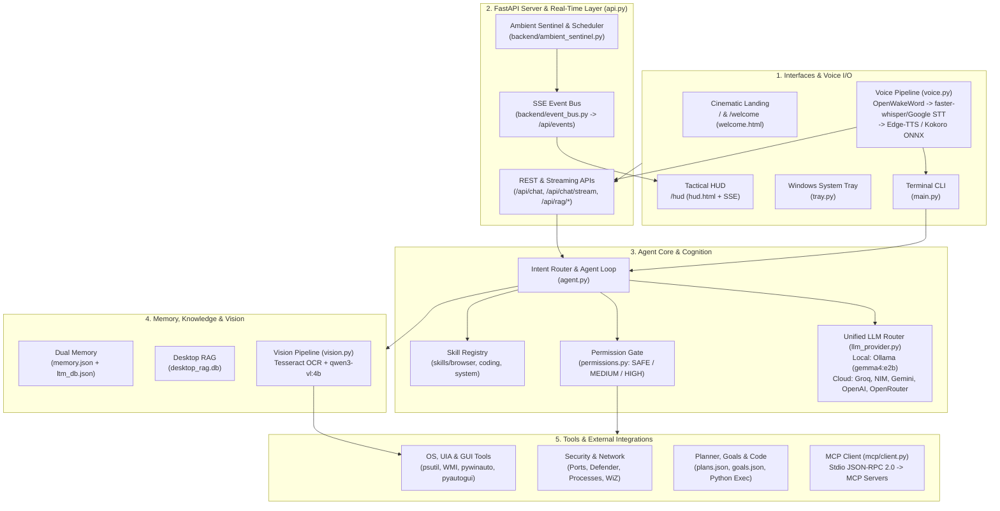

# AURA 2.0 — Autonomous Utility & Response Agent


**AURA 2.0** is a locally-hosted, multi-modal AI assistant paired with a **Cinematic Sci-Fi Landing Page** and a real-time **Tactical HUD Command Console**. By default, cognition and vision run locally via [Ollama](https://ollama.com/) (**Gemma 4 E2B** for reasoning and **Qwen3-VL 4B** for vision), while a unified provider router also supports cloud backends (**Groq**, **NVIDIA NIM**, **Google Gemini**, **OpenAI**, and **OpenRouter**). AURA 2.0 combines dynamic intent routing, multi-step planning, computer vision and UI automation, local Desktop RAG, MCP server integration, ambient context awareness, security scanning, and continuous voice interaction.

---

## ⚡ Highlights

- **Unified LLM Provider Router (`llm_provider.py`):** Run 100% locally via Ollama (`gemma4:e2b`) or switch in `.env` / HUD Settings to Groq, NVIDIA NIM, Google Gemini, OpenAI, or OpenRouter.
- **Cinematic Landing Page (`/` & `/welcome`):**
  - 3D mouse parallax tilt with smooth momentum lerp and 5-layer depth orbs (`static/welcome.html`).
  - Three.js orbital particle trails (`static/reactor.js`) synchronized to rotational physics.
  - CSS-animated feature card mini-demos, scroll progress indicator, live hero telemetry, and an interactive browser terminal.
- **Tactical HUD Command Console (`/hud`):**
  - 4 dynamic color themes (**Cyan**, **Crimson**, **Emerald**, **Violet**) with persistent UI config.
  - Real-time **Server-Sent Events (SSE)** stream (`backend/event_bus.py` → `/api/events`) pushing telemetry, process sweeps, threat alerts, ambient context, media state, schedules, and permission prompts without polling.
  - Spotlight panel search (`Ctrl + K`), audio waveform visualizer, and `SECURITY CLEARANCE` approval panel.
- **Dynamic Intent Router & Skill Registry:** Classifies requests in `agent.py`, selects minimal tool subsets per category, and injects matching skills from `skills/` (`browser`, `coding`, `system`).
- **Agentic Planner & Goals:** Multi-step autonomous task decomposition (`plans.json`, `goals.json`), dependency tracking, and live HUD progress updates.
- **Vision & Desktop Automation:** Combines `qwen3-vl:4b`, Tesseract OCR (`vision.py`), Windows UI Automation (`pywinauto` in `tools/uia_tools.py`), and GUI control (`pyautogui` in `tools/computer_control_tools.py`).
- **Offline-Capable Voice Pipeline (`voice.py`):**
  - **Wake Word:** Local OpenWakeWord (`models/hey_aura.onnx`) with barge-in guard, pre-roll one-shot capture, and optional speaker verification.
  - **STT:** 100% offline **faster-whisper** (`local`, default) or Google SpeechRecognition (`cloud`).
  - **TTS:** **Edge-TTS** (`edge`), 100% offline **Kokoro ONNX** (`kokoro`), or local `pyttsx3` fallback.
- **Dual Memory & Desktop RAG:** Short-term session context (`memory.json`), persistent semantic facts (`ltm_db.json`), and local document indexing/search (`desktop_rag.db` via `tools/rag_tools.py`).
- **Ambient Context Sentinel (`backend/ambient_sentinel.py`):** Passively tracks foreground window, active app, and clipboard context to inform proactive responses.
- **MCP Client Integration (`mcp/client.py`):** Connects via stdio JSON-RPC 2.0 to external Model Context Protocol servers configured in `config/mcp_servers.json`.
- **Local Security Center & Proactive Telemetry:** Scans listening ports, suspicious processes, Windows Defender/firewall status, removable devices, and home network devices, alongside a Windows System Tray daemon (`tray.py`).

---

## 🚀 Interactive Interfaces

| Interface | URL / Entrypoint | Description |
|---|---|---|
| **Cinematic Landing Page** | `http://127.0.0.1:8000/` (or `/welcome`) | Interactive showcase featuring 3D parallax, Three.js particle orbits, feature mini-demos, live telemetry, and interactive terminal. |
| **Tactical Command HUD** | `http://127.0.0.1:8000/hud` (or `/hud.html`) | Primary operational dashboard with 4 color themes, live SSE telemetry, audio visualizers, security clearance, and agent chat. |
| **System Tray Daemon** | `tray.py` / `start_aura.bat` | Background Windows taskbar daemon with quick-launch menu and server lifecycle management. |
| **CLI Terminal Mode** | `python main.py` | Direct text/voice terminal loop without launching the web server. |

---

## 🛠️ AURA 2.0 Visual Architecture



### Core Subsystems:
1. **Interfaces & Real-Time Bus:** `api.py` serves `static/welcome.html` and `static/hud.html`, while `backend/event_bus.py` broadcasts live change-detected payloads (`telemetry`, `threats_update`, `permissions_update`, `notifications_update`, `ambient_update`, `media`, `processes_update`, `schedule_update`, `security_update`, `logs_append`) over `/api/events`.
2. **Agent Core & LLM Router:** `agent.py` classifies intent, loads relevant skills from `skill_registry.py`, routes inference through `llm_provider.py` (Ollama local or cloud providers), and enforces safety gates via `permissions.py`.
3. **Vision & Desktop Control:** `vision.py` validates screenshots, extracts text with Tesseract OCR, and analyzes UI state with `qwen3-vl:4b` to drive `execute_visual_task` and `pywinauto` UIA actions.
4. **Memory & Desktop RAG:** `memory.py` manages conversational context (`memory.json`) and long-term facts (`ltm_db.json`), while `tools/rag_tools.py` indexes local documents into `desktop_rag.db`.
5. **Ambient Sentinel & MCP:** `backend/ambient_sentinel.py` tracks the active window and clipboard; `mcp/client.py` connects to stdio MCP servers defined in `config/mcp_servers.json` and exposes their tools dynamically.

---

## 📦 Prerequisites

- **Python 3.10+**
- **Windows OS** (required for WMI telemetry, Registry queries, UIA, and Windows Defender/firewall checks)
- **Ollama** installed and running ([Download Ollama](https://ollama.com/download))
- **Local Models** pulled in Ollama (required by `config.py` at startup):
  ```bash
  ollama pull gemma4:e2b
  ollama pull qwen3-vl:4b
  ```
- **Tesseract OCR** for screen text extraction ([Download Tesseract](https://github.com/UB-Mannheim/tesseract/wiki))
- **Microphone & Speakers** for wake-word and voice interaction

---

## 🔧 Installation & Setup

1. **Clone the Repository:**
   ```bash
   git clone https://github.com/your-repo/aura.git
   cd aura
   ```

2. **Install Dependencies:**
   ```bash
   pip install -r requirements.txt
   ```

3. **Configure Environment:**
   Copy `.env.example` to `.env` and adjust settings as needed:
   ```env
   AURA_LLM_PROVIDER=ollama
   OLLAMA_MODEL=gemma4:e2b
   OLLAMA_VISION_MODEL=qwen3-vl:4b
   AURA_STT_BACKEND=local
   AURA_TTS_BACKEND=edge
   ```
   To use a cloud LLM provider (`groq`, `nvidia`, `gemini`, `openai`, `openrouter`), set `AURA_LLM_PROVIDER` and the corresponding API key in `.env` (or configure it from the HUD settings panel).

4. **Optional Offline Voice Assets:**
   Use `download_offline_stt.bat` / `download_offline_voice.bat` (or `tools/download_faster_whisper.py` and `tools/download_kokoro_voice.py`) to pre-fetch local STT/TTS models.

---

## 🎮 Running AURA

### 1. Automated Launch (Recommended)
Double-click `start_aura.bat`. This requests Administrator privileges (for hardware sensors, event logs, and firewall inspections) and starts the `tray.py` daemon with the web server.

### 2. Manual Web Server Launch
Start the FastAPI / Uvicorn server directly (bound to loopback `127.0.0.1` for local-only security):
```bash
python -m uvicorn api:app --host 127.0.0.1 --port 8000
```
- **Landing Page:** `http://127.0.0.1:8000/`
- **Tactical HUD:** `http://127.0.0.1:8000/hud`

### 3. Classic Terminal Mode
Run AURA exclusively in the CLI for text/voice interactions without the web server:
```bash
python main.py
```

---

## 📂 Project Structure

```text
├── api.py                    # FastAPI server (REST, SSE /api/events, Landing, HUD, Scheduler)
├── agent.py                  # Core agent reasoning, Intent Router & tool dispatcher
├── llm_provider.py           # Unified LLM router (Ollama, Groq, NVIDIA, Gemini, OpenAI, OpenRouter)
├── main.py                   # CLI terminal interface
├── tray.py                   # Windows System Tray daemon
├── vision.py                 # Multi-modal vision pipeline (Tesseract OCR + Qwen3-VL)
├── voice.py                  # Wake-word (OpenWakeWord), STT (faster-whisper/Google), TTS (Edge/Kokoro)
├── memory.py                 # Conversation & long-term memory manager
├── permissions.py            # Security & tool execution permission gate
├── skill_registry.py         # Dynamic skill loader for skills/*/skill.json
├── planner_state.py          # Persistent multi-step plan state manager
├── notifications.py          # Notification queue for HUD & wake-word events
├── media_info.py             # Windows SMTC media session reader
├── config.py                 # Environment & path-safe configuration loader
├── requirements.txt          # Python dependencies
├── .env.example              # Reference environment configuration
├── backend/
│   ├── event_bus.py          # Asyncio SSE broadcast hub
│   └── ambient_sentinel.py   # Foreground window & clipboard context monitor
├── mcp/
│   ├── client.py             # Stdio JSON-RPC 2.0 MCP client
│   └── servers/              # Local MCP servers (e.g., echo_server.py)
├── skills/                   # Domain skill definitions (browser, coding, system)
├── config/                   # mcp_servers.json & quick_actions.json
├── static/
│   ├── welcome.html          # Cinematic landing page
│   ├── landing.css / .js     # Landing page styles, parallax & terminal
│   ├── reactor.js            # Three.js orbital particle engine
│   ├── hud.html              # Tactical HUD interface
│   ├── style.css / tokens.css# HUD themes & design tokens
│   └── script.js / realtime.js / boot.js  # HUD client & SSE handler
├── tools/
│   ├── __init__.py           # Unified tool exports
│   ├── ambient_tools.py      # Ambient context queries
│   ├── app_tools.py          # Application launcher/closer
│   ├── computer_control_tools.py # Closed-loop GUI automation (pyautogui + VLM)
│   ├── diagnostic_tools.py   # Self-diagnostics
│   ├── file_tools.py         # Directory listing & file reading
│   ├── goal_tools.py         # Persistent goal tracking
│   ├── interpreter_tools.py  # Sandboxed Python code execution
│   ├── mcp_tools.py          # MCP server listing, reload & tool invocation
│   ├── memory_tools.py       # Long-term knowledge read/write/forget
│   ├── planner_tools.py      # Multi-step plan creation & progress reporting
│   ├── rag_tools.py          # Local Desktop RAG indexing & querying
│   ├── security_tools.py     # Threat scan, firewall, Defender & listening ports
│   ├── smart_home_tools.py   # WiZ smart home discovery & control
│   ├── spotify_tools.py      # Spotify playback & search
│   ├── system_tools.py       # OS info, media, power, schedule & screen read
│   ├── uia_tools.py          # Windows UI Automation (pywinauto)
│   ├── web_tools.py          # Web search (ddgs)
│   └── windows_tools.py      # CPU, GPU, RAM, disk, battery, services & event logs
└── tests/                    # Pytest suite (health, tools, RAG, MCP, voice, UI)
```

---

## 🔐 Tool Permission Levels

Every tool call passes through `permissions.py` before execution:

| Level | Behavior | Examples |
|---|---|---|
| **SAFE / LOW** | Runs immediately | System info, web search, read file, security status scanners (`get_listening_ports`, `get_suspicious_files`, `get_removable_devices`, `analyze_suspicious_processes`) |
| **MEDIUM** | Needs approval unless **Trusted Mode** is ON in the HUD | Open/close apps, media, smart home, screen capture (`read_screen`), `run_threat_scan` |
| **HIGH / CRITICAL** | Always needs approval via the HUD **SECURITY CLEARANCE** panel or a conversational `"yes"` | GUI automation (`execute_visual_task`), memory deletion (`forget_memory`), shutdown/restart |

Pending actions appear in the HUD panel with **AUTHORIZE / REJECT** buttons; approving makes AURA re-run the tool automatically.

---

## 🎙️ Voice Pipeline Privacy

- **Wake Word (`"Hey Aura"`):** Fully offline via local OpenWakeWord (`models/hey_aura.onnx`). Test standalone with `python test_wakeword.py --duration 30`.
- **Speech-to-Text (STT):** Defaults to `AURA_STT_BACKEND=local` (**faster-whisper**, 100% offline). Switching to `cloud` uses Google SpeechRecognition, which sends audio clips to Google's servers.
- **Text-to-Speech (TTS):** Defaults to `AURA_TTS_BACKEND=edge` (Microsoft Edge-TTS cloud neural service). Set `AURA_TTS_BACKEND=kokoro` for 100% offline local neural TTS, or rely on the offline `pyttsx3` fallback.

---

## 🧪 Testing

Run the test suite with `pytest`:
```bash
pytest tests/
```

---

## ⚠️ Known Limitations

- The wake-word model can false-trigger on long sustained tones (~1 kHz); keep `AURA_WAKEWORD_THRESHOLD` at `0.60+` if this affects you.
- On 4 GB VRAM GPUs, `gemma4:e2b` partially offloads to CPU: expect ~10–30 s per response and a slower intent-router pass. Lower `OLLAMA_NUM_CTX`, disable the router with `AURA_INTENT_ROUTER=off`, or switch `AURA_LLM_PROVIDER` to a cloud provider to reduce latency.
- Running both the local main model and vision model back-to-back causes model load/unload churn in Ollama on small VRAM budgets.

---

## ⌨️ Interactive Features & Easter Eggs

- **HUD Color Themes:** Click the 4 theme dots under `SIGNAL / UPLINK` on the HUD to switch between Cyan, Crimson, Emerald, and Violet.
- **Spotlight Panel Search:** Press `Ctrl + K` in the HUD to quickly jump to any diagnostic panel.
- **Feature Card Mini-Demos:** Hover over any of the 6 feature cards on the landing page to view interactive animated mockups.
- **Interactive Landing Terminal:** Type `help`, `status`, `scan`, `whoami`, `ping`, `threat`, `time`, or `about` directly in the browser terminal.
- **Web Audio Sound Effects:** Click the speaker icon in the navigation bar to toggle cybernetic interaction audio.
- **Konami Code:** Press `↑ ↑ ↓ ↓ ← → ← → B A` on the landing page for a secret visual overload!

---

## 🛡️ License

Created for personal and educational use. Local models and offline voice backends keep data on-device; see *Voice Pipeline Privacy* and *Unified LLM Provider Router* for optional cloud integrations.
